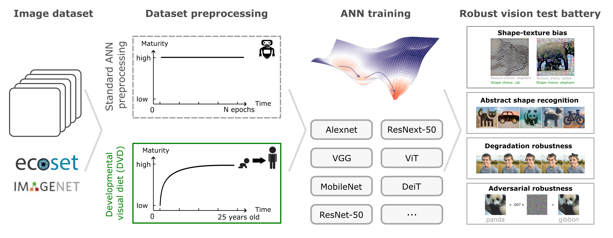

# Scale-Free Developmental Visual Diet (DVD)

[](https://arxiv.org/abs/2507.03168)
[](https://opensource.org/licenses/MIT)



DVD is an image curriculum that models age-dependent visual acuity, contrast sensitivity, and color sensitivity during network training.

**DVD scale-free v1 (Endpoint Linear version).** The default DVD configuration is forward training at `V = 1`, with acuity, contrast, and color enabled. The training CLI uses DVD when requested; standard adult-input training remains its default.


## Quick Start

```sh
git clone --branch scale_free https://github.com/KietzmannLab/DVD.git
cd DVD
python -m pip install -e '.[demo,train]'
```

For only the Python transform, install with `python -m pip install -e .`.

```python
import torch
from dvd_scale_free import DVDConfig, DVDTransformer

dvd = DVDTransformer(DVDConfig())
x = torch.rand(1, 3, 256, 256)
y, diagnostics = dvd(x, months=48, return_diagnostics=True)
print(y.shape, diagnostics[0]["adult_anchor_cpd"])
```

Use float tensors in `[0, 1]`, before model normalization, in `CHW` or `NCHW` format. Single-channel images skip color development. For RGBA, only RGB is filtered. The transform keeps the input size unless `image_size` is set to a long-edge length or an explicit `(height, width)`. It runs without autograd.

```sh
python -m scripts.dvd_image assets/example_stimuli/example_1.jpeg dvd_48mo.png --months 48
python tests/dvd_images_demo.py --output dvd_gallery.pdf
```

## DVD Settings

1. **Acuity:** A reflected Gaussian filter is evaluated in angular frequency units (cycles per degree, cpd).
2. **Contrast:** The luminance spectrum after acuity filtering gives two radial contrast-amplitude anchors. The threshold interpolates linearly between their amplitudes according to contrast maturation. A log-amplitude sigmoid attenuates frequencies below the threshold while preserving DC.
3. **Color:** The original DVD age-dependent grayscale-to-RGB blend is applied after the spatial stages.

| Setting | Default and meaning |
| :--- | :--- |
| `speed` (V) | `1.0` uses the original acuity, contrast, and color fits. At a given month, `V > 1` advances the selected curves and `0 < V < 1` delays them. |
| `speed_components` | `("acuity", "contrast", "color")` by default. Select any subset, or use `()` to leave all timing unchanged. Unselected stages still develop at their original rate; `apply_acuity`, `apply_contrast`, and `apply_color` separately control whether a stage runs. |
| `fov_deg`, `vertical_fov_deg` | Horizontal visual angle is 15 degrees; by default, vertical angle follows the source aspect ratio. |
| `infant_anchor_cpd` | `0.23` cpd; `"fundamental"` uses the lowest nonzero sampled frequency. |
| `adult_anchor_cpd` | `None` (auto): `0.98 * 224 / (2 * 15)` cpd (about 7.3173), capped at 98% of the smaller axis Nyquist frequency. To override, pass a number or `"nyquist"` to use the actual grid's capped Nyquist frequency. |
| `sigmoid_width_log10` | `0.10` log10 amplitude units. |

Forward visual acuity has its own clock. For elapsed age fraction `u = t / 300`, a selected acuity stage evaluates the original double-exponential Gaussian width at `300 * V * u / (1 - u + V * u)` months. This is a time warp, not a contrast-sensitivity fit. Contrast retains `p = H(t) ** (1 / V)`, where `H` is the human contrast Hill fit normalized at 300 months. Selected color retains its previous timing at `inverse_H(p)`. These settings change timing, not the underlying fits or the birth and 300-month endpoints. Retiming acuity can change the image spectrum used to compute the contrast threshold, even when contrast timing is held fixed.

To reproduce the previous contrast-only behavior at a non-unit V:

```python
contrast_only = DVDTransformer(DVDConfig(speed=0.5, speed_components=("contrast",)))
```

```sh
python -m scripts.dvd_image input.jpg slower_contrast.png --months 48 --speed 0.5 --speed-components contrast
```

The adult contrast endpoint is still filtered. The demo-only `--unfiltered-at-300` returns the prepared input unchanged at 300 months and later; do not use it to reproduce training. The browser's slider limits are not training constraints.

### Inverse DVD and Crop Controls

Two independent spectral switches select the starting region:

| Invert frequency | Invert amplitude | Starting region | Preset |
| :---: | :---: | :--- | :--- |
| Off | Off | Coarse frequencies, strong amplitudes | Forward DVD |
| On | Off | Fine frequencies, strong amplitudes | Frequency-inverted control |
| Off | On | Coarse frequencies, weak amplitudes | Amplitude-inverted, exploratory |
| On | On | Fine frequencies, weak amplitudes | Full-color inverse-DVD |

```python
from dvd_scale_free import RRCConfig, make_curriculum, training_rrc

dvd = make_curriculum(invert_frequency=True, invert_amplitude=True, speed=1.0)
crop = training_rrc(256, RRCConfig(enabled=True, scale=(0.08, 1.0)))
aged = dvd(crop(x) if crop is not None else x, months=24)
```

At V=1, the original forward transform is unchanged: its frequency line is the Gaussian half-gain and its amplitude gate acts on radial means. The flipped controls instead use calibrated Fourier coefficients on the even-reflected field, with two soft gates. For flips, `acuity` retimes the frequency gate and `contrast` retimes the amplitude gate. To preserve the previous flipped-mode behavior, select `("acuity", "contrast")`. Both flips at V=1 match the full-color 256 px inverse-DVD filter from the steering experiments. Flipped modes are full-color by default and return the input unchanged at 300 months. Random grayscale is also off by default for flipped modes in the training CLI.

```sh
python -m scripts.main --describe-dvd --development-strategy dvd \
  --invert-frequency --invert-amplitude --rrc --rrc-scale 0.08 1.0
python -m scripts.dvd_image input.jpg inverse.png --months 12 --invert-frequency --invert-amplitude
```

Add those flags to the training command below. RRC is **off by default** and is never applied in validation. `--rrc` enables it independently of the DVD mode; `--rrc-scale MIN MAX` changes the area fraction and `--rrc-ratio MIN MAX` changes the aspect ratios (default 3:4 to 4:3). CLI crop draws use Kornia, not the browser's preview seed. The published paper augmentation has no RRC unless explicitly enabled.

For transfer, keep the visual field and aspect ratio fixed (do not stretch the input). The flipped modes calibrate their birth amplitude quantile in a fixed physical 256 px reference band capped at the actual common Nyquist frequency. `--inverse-native-band` uses the complete sampled band instead. Very low resolutions may not support the requested birth frequency. Matching the physical filter does not guarantee invariant RN50 accuracy or shape bias across input resolutions.

## Training

Inspect the CLI defaults without loading data or allocating a GPU:

```sh
python -m scripts.main --development-strategy dvd --describe-dvd
```

For example, to use chronological V=1 on two GPUs with 150 epochs and two developmental months per epoch:

```sh
WANDB_MODE=offline torchrun --standalone --nproc-per-node=2 -m scripts.main /data \
  --dataset-name imagenet --imagenet-path /data/imagenet --arch resnet50 \
  --development-strategy dvd \
  --time_order chronological --months_per_epoch 2 --epochs 150 \
  --image-size 256 --batch-size-per-gpu 512 --lr 1e-4 --label-smoothing 0 --seed 0
```

- Contrast is **on** by default when DVD is selected. In the native P004 launcher, `--apply_contrast 0` disabled only the superseded paper contrast filter. Here it disables DVD contrast; do not copy that flag.
- To retime only contrast, use `--dvd-speed 0.5 --dvd-speed-components contrast`. To retime multiple curves, list them after the flag (e.g., `acuity contrast`).
- The training transform uses chunked, batched real FFTs for square float32 RGB or single-channel batches at least 224 px with default geometry and both spatial stages enabled. Other settings or diagnostic requests use the reference path, which can be slower. `--dvd-backend batched` requires the accelerated path; `--dvd-chunk-size` controls its temporary memory.
- Validation uses adult (unfiltered) inputs. Checkpoints record the filter, schedule, and selected speed components; resume with matching settings. Use a separate working directory for independent runs.

### P004 Paper Runner

The opt-in recipe ports the P004 runner used for the forward DVD V=1 RN50 experiment. It does not change the general trainer. It requires a full ImageNet-1K ImageFolder tree and two CUDA GPUs on one node:

```sh
python -m scripts.main --training-recipe p004-paper --describe-dvd

torchrun --standalone --nproc-per-node=2 -m scripts.main \
  --training-recipe p004-paper \
  --imagenet-path /path/to/imagenet --output-dir runs/p004-paper-v1
```

| Component | P004 paper recipe |
| :--- | :--- |
| Inputs and augmentation | Ordered JPEGs and common labels from ImageFolder. PIL short-edge resize, then full-frame bilinear 256 px resize (`align_corners=True`, no tensor antialias). Paper Kornia operators draw parameters per image in GPU batches, before FP32 DVD. No RRC or Recipe B. |
| Schedule and optimizer | 150 epochs, 1,251 steps per epoch, 2 months per epoch, 512 images per rank, seed 0 by default. Class-weighted cross-entropy, fused Adam at `1e-4` with `weight_decay=1e-6`, channels-last layout, FP16 model autocast, GradScaler, and the full-batch SyncBN path. |
| Validation and best | Eager inference on 50,000 unfiltered adult images, without augmentation. Both ranks reduce weighted loss and hit counts; best is chosen by whole-set top-1. |
| Inputs and restart verification | Check ImageNet split sizes and class mapping and compare ordered ID hashes and sampled JPEG hashes on both ranks. Save the manifest, library versions, age schedule, optimizer/scaler, and each rank's separate RNG state. Last, best, and periodic checkpoints are written atomically. |

On the lab cluster, omitting the data path reads `/share/klab/datasets/cached_datasets/imagenet_p004` directly. No dataset cache is copied to RAM or local scratch. The paper loader uses bounded batch queues (24 train and 8 validation workers per rank by default); `/dev/shm` is needed for the queues, not for the dataset itself. The runner checks for 80 GiB available RAM and 24 GiB free shared-memory space when the Linux counters are available. For Slurm, the reference allocation is `--mem=105G --cpus-per-task=60` for both ranks together. A known Slurm RAM allocation below 80 GiB is rejected even if the node has ample free RAM.

Continue a new run with the same options and `--resume runs/p004-paper-v1/weights/checkpoint_last.pth`. For a trusted native `linear_v1` checkpoint, the runner checks the saved paper flags, age schedule, and optimizer; continuing training additionally requires both original rank RNG states. Use a new output directory for that continuation and retain the original best checkpoint. To replay ImageNet validation without training or writing checkpoints, use the paper recipe with `--evaluate --resume /path/to/checkpoint_best.pth` and the same ImageNet split.

Use the same ImageNet bytes, PyTorch/CUDA, torchvision, Kornia, and Pillow versions, and comparable GPU topology for quantitative retraining comparisons. The original B200 protocol used the torch 2.7.1 / CUDA 12.8 stack. The data manifest hashes all ordered IDs and labels, but only spot-checks JPEG bytes. A new run is not a bitwise reproduction of the archived weights: GPU FFT/scatter arithmetic and the exact original resume history still matter. Replaying the paper metrics requires the archived checkpoint and evaluation inputs, not a fresh training run.

### Replaying an Existing Experiment

The general CLI selects the same V=1 **visual transform** as P004 under the matching input geometry, but retains its separate trainer. Its CPU sample augmentations, Adam defaults and rank-local validation are not a replay of the P004 protocol. Use the paper runner above for a retraining comparison and the original checkpoint and evaluation preprocessing for exact analysis replay.

For the matched shape/texture steering comparison, use the frozen best-validation RN50 checkpoints rather than retraining from the switches: standard e103, forward e148, full-color inverse e143, and full-color inverse with RRC e147. The inverse runs used the original packed, GPU-augmented pipeline. The matched RRC run used area `(0.08, 1.0)` and ratio `(0.75, 4/3)`, and neither inverse run used random grayscale. The reported scores were measured on unfiltered adult RGB (ImageNet at 256 px; cue conflict at 224 px).

### Version History

- The [last revision shipping the legacy method and the original v1 names](https://github.com/KietzmannLab/DVD/tree/413842b9d90d3a436ce6c32595552e204a2150cd) is `413842b`. Use that revision in a separate environment to replay log-frequency scale-free runs with `--dvd-method legacy` or `cs_logspan_start`. Those settings do not translate to v1.
- The v1 forward API now uses `DVDConfig` and `DVDTransformer` from `dvd_scale_free`. In training commands, drop `--dvd-method endpoint-linear` and change `--endpoint-*` flags to `--dvd-*`. This renames the same algorithm; it does not change the filters or defaults.
- New checkpoints identify the method as `dvd`. Use an explicit `--resume` path for previous v1 runs: the runner accepts the prior method name only if the remaining protocol matches. The numeric protocol schema is separate from the method's v1 name. A checkpoint trained with the earlier Hill-retimed acuity still requires its original revision.

### Tests

```sh
python -m unittest discover -s tests -v
```

On a CUDA node with two GPUs, `PYTHONPATH=. python tests/paper_cuda_smoke.py /path/to/new-smoke-directory` exercises the paper runner on synthetic JPEGs, including optimization, distributed validation, checkpoint save, and a separate-process resume. It does not train the full ImageNet model.

## Datasets

| Dataset   | Description                                                               | Link |
|-----------|---------------------------------------------------------------------------|------|
| **Ecoset** | A natural image dataset introduced in Mehrer et al., 2021                 | [Ecoset Website](https://www.kietzmannlab.org/ecoset/) |
| **ImageNet** | Our models were also trained on the initial release of ImageNet         | [ImageNet Website](https://www.image-net.org/) |

---

## Citation

If you use DVD in your research, please cite our work:

```bibtex
@article{lu2026developmental,
  title={Adopting a human developmental visual diet yields robust and shape-based AI vision},
  author={Lu, Zejin and Thorat, Sushrut and Cichy, Radoslaw M. and Kietzmann, Tim C.},
  journal={Nature Machine Intelligence},
  pages={1-14},
  year={2026}
}
```
