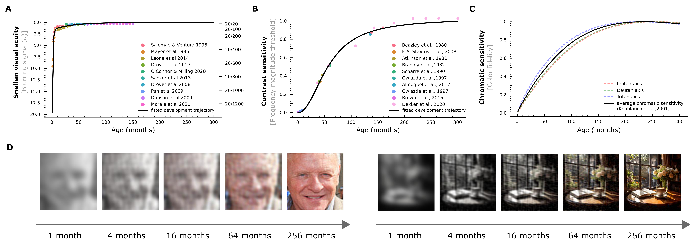

# Scale-Free Developmental Visual Diet (DVD)

[](https://arxiv.org/abs/2507.03168)
[](https://opensource.org/licenses/MIT)


DVD is an image curriculum that models age-dependent visual acuity, contrast sensitivity, and color sensitivity during network training.

**Latest on `scale_free`: Endpoint Linear DVD (V = 1).** The original scale-free implementation is still available in `dvd_scale_free/dvd_scale_free/development.py` with its existing API and defaults. The training CLI uses the new method only when DVD is requested; standard adult-input training remains the CLI default.



## Quick Start

```sh
git clone --branch scale_free https://github.com/KietzmannLab/DVD.git
cd DVD
python -m pip install -e '.[demo,train]'
```

For only the new Python transform, install with `python -m pip install -e .`. For the original Python transform, install with `python -m pip install -e '.[legacy]'`.

```python
import torch
from dvd_scale_free.dvd_scale_free.endpoint_linear import EndpointConfig, EndpointLinearDVD

dvd = EndpointLinearDVD(EndpointConfig(speed=1.0))
x = torch.rand(1, 3, 256, 256)
y, diagnostics = dvd(x, months=48, return_diagnostics=True)
print(y.shape, diagnostics[0]["adult_anchor_cpd"])
```

Use float tensors in `[0, 1]`, before model normalization, in `CHW` or `NCHW` format. Single-channel images skip color development. For RGBA, only RGB is filtered. The transform keeps the input size unless `image_size` is set to a long-edge length or an explicit `(height, width)`. It runs without autograd.

```sh
python -m scripts.dvd_image assets/example_stimuli/example_1.jpeg endpoint_48mo.png --months 48
python tests/dvd_images_demo.py --output endpoint_gallery.pdf
python tests/dvd_images_demo.py --dvd-method legacy --output legacy_gallery.pdf
```

## Endpoint Linear Settings

1. **Acuity:** A reflected Gaussian filter is evaluated in angular frequency units (cycles per degree, cpd).
2. **Contrast:** The luminance spectrum after acuity filtering gives two radial contrast-amplitude anchors. The threshold interpolates linearly between the two amplitudes using `p = H(age) ** (1 / V)`, where the human Hill fit `H` is normalized at 300 months. A log-amplitude sigmoid attenuates frequencies below the threshold while preserving DC.
3. **Color:** The original DVD age-dependent grayscale-to-RGB blend is applied after the spatial stages.

| Setting | Default and meaning |
| :--- | :--- |
| `speed` (V) | `1.0` follows the human contrast curve. Larger positive values advance contrast maturation at a given age; smaller positive values slow it. V does not change the acuity or color curves. |
| `fov_deg`, `vertical_fov_deg` | Horizontal visual angle is 15 degrees; by default, vertical angle follows the source aspect ratio. |
| `infant_anchor_cpd` | `0.23` cpd; `"fundamental"` uses the lowest nonzero sampled frequency. |
| `adult_anchor_cpd` | `None` (auto): `0.98 * 224 / (2 * 15)` cpd (about 7.3173), capped at 98% of the smaller axis Nyquist frequency. To override, pass a number or `"nyquist"` to use the actual grid's capped Nyquist frequency. |
| `sigmoid_width_log10` | `0.10` log10 amplitude units. |

The adult contrast endpoint is still filtered. The demo-only `--unfiltered-at-300` returns the prepared input unchanged at 300 months and later; do not use it to reproduce training. The browser's slider limits are not training constraints.

### Legacy Scale-Free DVD

The legacy path retains its log-frequency progress remapping, scale-free band settings, optional CSF and decomposition modes, and Gaussian or frequency-cutoff acuity. An Endpoint Linear V value is not a substitute for legacy `cs_logspan_start`.

```python
from dvd_scale_free.dvd_scale_free.development import DVDConfig, DVDTransformer

legacy = DVDTransformer(DVDConfig(image_size=256, cs_logspan_start=0.005))
y_legacy = legacy(x, months=48)
```

## Training

Inspect the CLI defaults without loading data or allocating a GPU:

```sh
python -m scripts.main --development_strategy dvd --describe-dvd
```

For example, to use chronological V=1 on two GPUs with 150 epochs and two developmental months per epoch:

```sh
WANDB_MODE=offline torchrun --standalone --nproc-per-node=2 -m scripts.main /data \
  --dataset-name imagenet --imagenet-path /data/imagenet --arch resnet50 \
  --development_strategy dvd --dvd-method endpoint-linear \
  --time_order chronological --months_per_epoch 2 --epochs 150 \
  --image-size 256 --batch-size-per-gpu 512 --lr 1e-4 --label-smoothing 0 --seed 0
```

- Use `--dvd-method legacy` for the original scale-free CLI. For example, `--cs_logspan_start 0.005` selects the legacy remapping parameter. The legacy CLI defaults to enabling the optional Barten CSF; add `--contrast_use_barten_csf 0` to match the legacy Python API defaults.
- The new training transform uses chunked, batched real FFTs for square float32 RGB or single-channel batches at least 224 px with default geometry and both spatial stages enabled. Other settings or diagnostic requests use the reference path, which can be slower. `--endpoint-backend batched` checks that the training input can use the accelerated path; `--endpoint-chunk-size` controls its temporary memory.
- Validation uses adult (unfiltered) inputs. Endpoint Linear checkpoints record the filter and schedule; resume with matching options. Use a separate working directory for independent runs.

### Replaying an Existing Experiment

This CLI selects the same V=1 **visual transform** as the P004 paper-augmentation run. It is **not** the same full training recipe. The original run also fixed ImageNet sample and class order, augmentation and resizing, optimizer and precision, distributed batch construction and random states, and checkpoint selection. It used GPU-batched paper augmentation and a specialized training and validation runtime. Matching V, age, and resolution alone does not reproduce that checkpoint, its validation accuracy, or its epoch time. Use the original checkpoint and evaluation preprocessing for exact analysis replay; use the original launcher and environment for a retraining comparison.

### Tests

```sh
python -m unittest discover -s tests -v
```

## Datasets

| Dataset   | Description                                                               | Link |
|-----------|---------------------------------------------------------------------------|------|
| **Ecoset** | A natural image dataset introduced in Mehrer et al., 2021                 | [Ecoset Website](https://www.kietzmannlab.org/ecoset/) |
| **ImageNet** | Our models were also trained on the initial release of ImageNet         | [ImageNet Website](https://www.image-net.org/) |

---

## Citation

If you use DVD in your research, please cite our work:

```bibtex
@article{lu2026developmental,
  title={Adopting a human developmental visual diet yields robust and shape-based AI vision},
  author={Lu, Zejin and Thorat, Sushrut and Cichy, Radoslaw M. and Kietzmann, Tim C.},
  journal={Nature Machine Intelligence},
  pages={1-14},
  year={2026}
}
```
